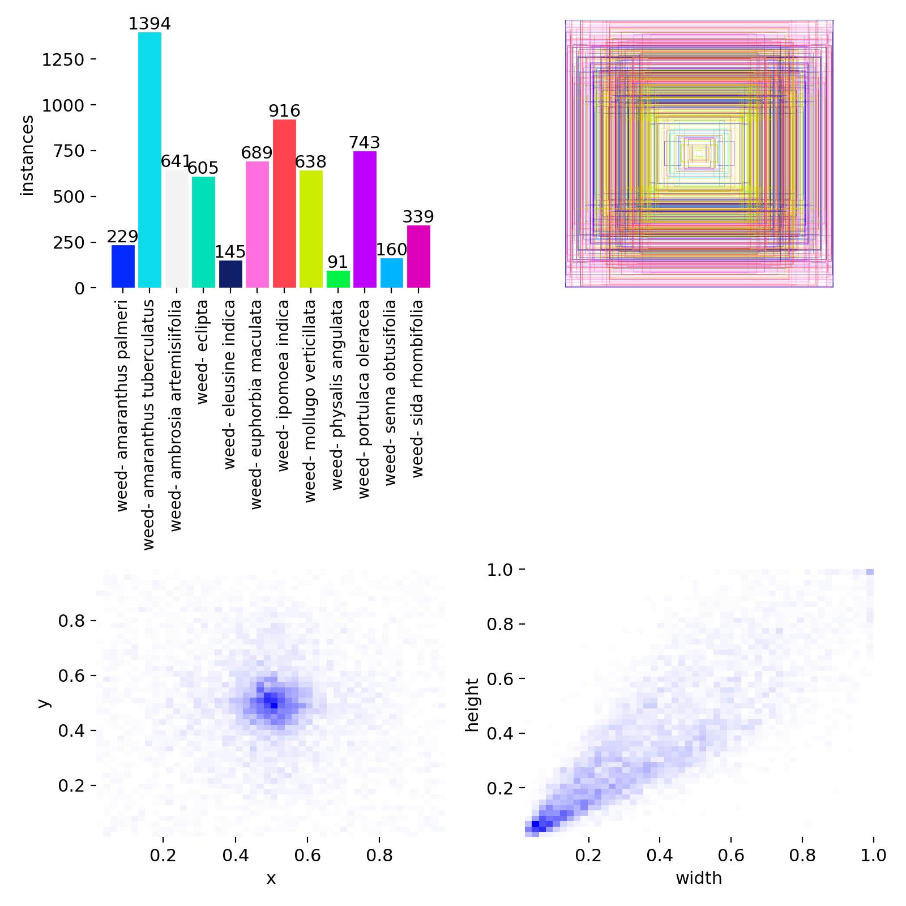
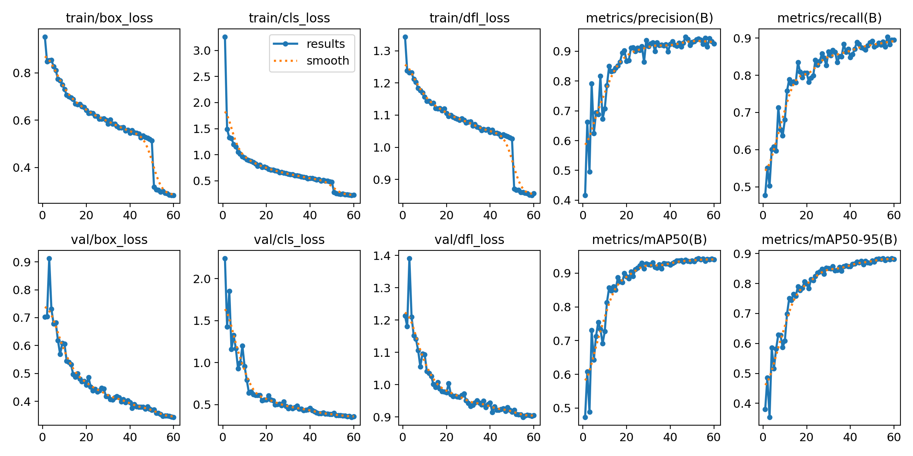
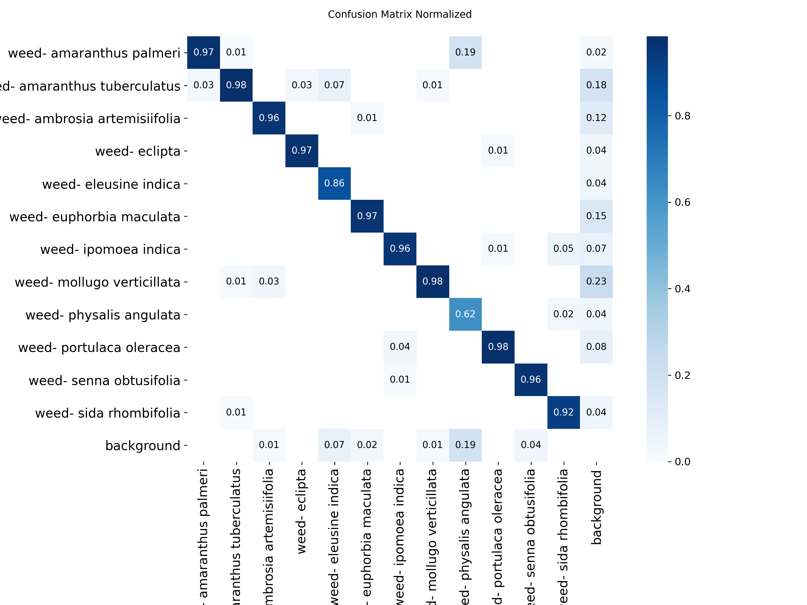
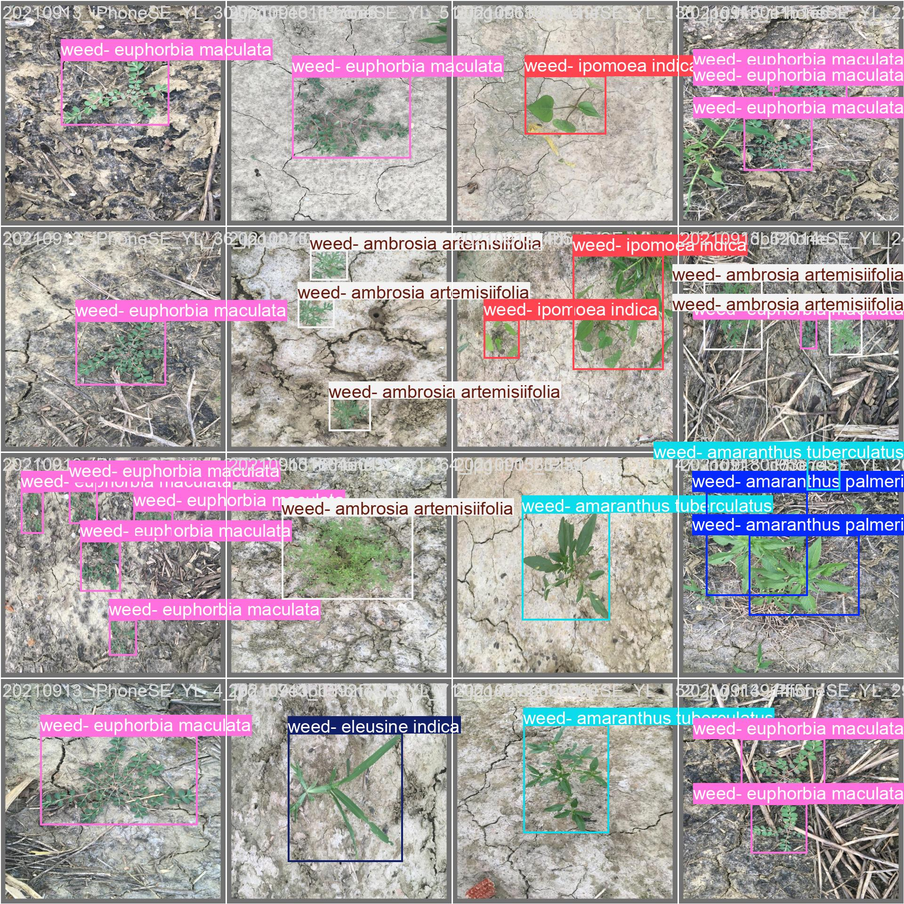
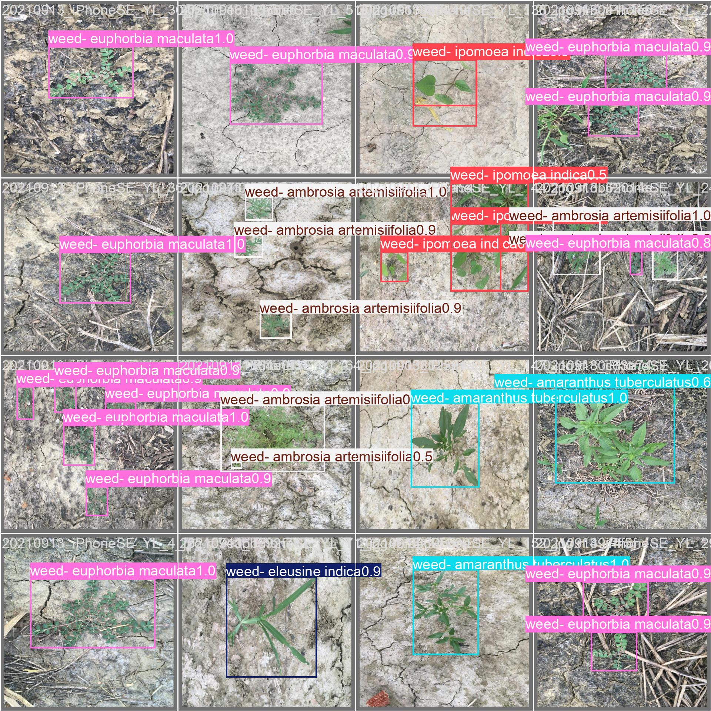
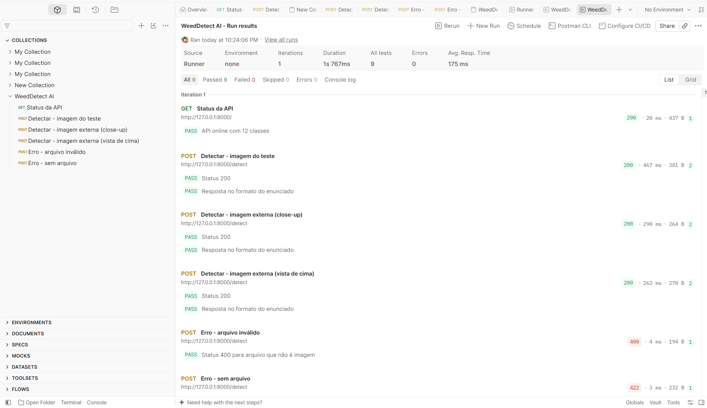

# 🌱 WeedDetect AI

API de detecção de plantas daninhas em lavouras de algodão, usando **YOLO11s** e **FastAPI**.

O modelo identifica **12 espécies de plantas daninhas** em uma imagem e devolve, para cada uma, a classe, a confiança e a caixa delimitadora (bounding box) em pixels. Com essas coordenadas, um sistema de pulverização localizada pode aplicar herbicida só onde existe daninha, em vez de pulverizar a área inteira.

> Projeto Avaliativo do Módulo 2 — SCTEC, Machine Learning e Visão Computacional.

**🚀 Teste online:** [abrir a API publicada (Swagger)](https://weeddetect-ai-485873057830.us-central1.run.app/docs). Veja o passo a passo e as imagens de teste em [Teste online](#-teste-online).

---

## 📋 Sumário

- [Teste online](#-teste-online)
- [Tecnologias](#%EF%B8%8F-tecnologias)
- [Contexto e motivação](#-contexto-e-motivação)
- [Dataset](#-dataset)
- [Modelo e treinamento](#-modelo-e-treinamento)
- [Resultados](#-resultados)
- [Limitações](#%EF%B8%8F-limitações)
- [Como rodar a API](#-como-rodar-a-api)
- [Endpoints](#-endpoints)
- [Testes no Postman](#-testes-no-postman)
- [Estrutura do projeto](#-estrutura-do-projeto)
- [Gestão do projeto](#-gestão-do-projeto)
- [Créditos](#-créditos)

---

## 🧪 Teste online

A API está publicada no **Google Cloud Run** e pode ser testada direto pelo navegador, no computador ou no celular, sem instalar nada.

### 1. Baixe uma imagem de teste

O modelo foi treinado para reconhecer **12 espécies de daninhas de lavouras de algodão**, fotografadas **de cima, com o solo em volta**. Para ver o modelo funcionando como foi projetado, use as imagens abaixo. Elas são do **conjunto de teste do dataset**, ou seja, o modelo **nunca as viu** durante o treino.

| Imagem | Resultado esperado |
|---|---|
| [01_mollugo_verticillata.jpg](https://github.com/charlesmrs/weeddetect-ai/raw/main/test_images/01_mollugo_verticillata.jpg) | *Mollugo verticillata* (confiança ≈ 0,92) |
| [02_amaranthus_palmeri.jpg](https://github.com/charlesmrs/weeddetect-ai/raw/main/test_images/02_amaranthus_palmeri.jpg) | *Amaranthus palmeri* (≈ 0,98) |
| [03_duas_daninhas.jpg](https://github.com/charlesmrs/weeddetect-ai/raw/main/test_images/03_duas_daninhas.jpg) | Duas detecções: *Amaranthus palmeri* (≈ 0,97) e *Mollugo verticillata* (≈ 0,53) |
| [04_amaranthus_palmeri.jpg](https://github.com/charlesmrs/weeddetect-ai/raw/main/test_images/04_amaranthus_palmeri.jpg) | *Amaranthus palmeri* (≈ 0,98) |

No celular: abra o link, segure o dedo sobre a imagem e escolha **Salvar imagem**. No computador: abra o link e use **Salvar imagem como...**.

### 2. Envie a imagem para a API

1. Abra o **[Swagger da API](https://weeddetect-ai-485873057830.us-central1.run.app/docs)**.
2. Clique em **POST /detect** e depois em **Try it out**.
3. Em **file**, escolha a imagem que você baixou.
4. Clique em **Execute** e veja o JSON em **Response body**.

### ⚠️ Antes de testar, saiba que

- **A primeira requisição pode levar até 30 segundos.** Quando ninguém usa a API, o Cloud Run desliga o servidor para não gerar custo. No primeiro acesso, ele liga o container e carrega o modelo (*cold start*). As requisições seguintes respondem em menos de 1 segundo.
- **Use fotos JPG ou PNG.** Outros formatos são recusados com o erro `400`. No iPhone, as fotos da câmera usam o formato HEIC por padrão; para tirar fotos em JPG, vá em **Ajustes > Câmera > Formatos > Mais Compatível**.
- **Fotos de outras plantas ou em outras condições podem dar resultados errados.** O modelo só conhece as 12 espécies do dataset, fotografadas de cima. Uma planta diferente, um close-up ou uma foto com flores pode resultar numa lista `detections` vazia ou numa classe errada com confiança baixa. Isso é uma limitação do modelo, e não uma falha da API (veja [Limitações](#%EF%B8%8F-limitações)). As imagens `externa_portulaca_vista_de_cima.png` e `externa_portulaca_closeup.png`, na pasta [`test_images/`](test_images), mostram esse efeito.

---

## 🛠️ Tecnologias

| Tecnologia | Para que foi usada | Por que é importante |
|---|---|---|
| **Python 3.11** | Linguagem de todo o projeto | É a linguagem padrão de Machine Learning, com o maior ecossistema de bibliotecas de IA. |
| **YOLO11s (Ultralytics)** | Modelo de detecção de objetos | Detecta **onde** e **quantas** daninhas há na imagem, em uma única passada ("You Only Look Once"), rápido o bastante para rodar em tempo real num pulverizador ou drone. |
| **PyTorch** | Base do YOLO, para treino e inferência | É o framework de deep learning por trás do YOLO; no servidor, roda a versão só para CPU, mais leve. |
| **Fine-tuning (transfer learning)** | Adaptar o YOLO pré-treinado às 12 daninhas | Aproveita o que o modelo já sabe sobre formas e texturas (aprendido no dataset COCO) e exige muito menos dados e tempo de treino do que começar do zero. |
| **Roboflow** | Download do dataset já no formato YOLO | Entrega as imagens e as anotações prontas para o treino, sem conversão manual. |
| **Google Colab (GPU L4)** | Ambiente de treino | Oferece GPU na nuvem: o treino levou 36 minutos, contra muitas horas num computador comum. |
| **FastAPI** | Construção da API | Transforma o modelo num serviço que qualquer sistema pode usar via HTTP, valida as entradas automaticamente e gera a documentação Swagger sozinho. |
| **Uvicorn** | Servidor da API | Executa a aplicação FastAPI e atende as requisições de forma assíncrona. |
| **Docker** | Empacotamento da API | Junta Python, bibliotecas, código e modelo numa "caixa" que roda igual em qualquer servidor, eliminando o problema do "na minha máquina funciona". |
| **Google Cloud Run** | Publicação da API na internet | Executa o container sob demanda e desliga quando não há uso, o que mantém o custo próximo de zero; `--max-instances 1` limita o gasto. |
| **Postman** | Testes automáticos da API | Verifica códigos de resposta e o formato do JSON, incluindo os casos de erro (`400`, `422`). |
| **Git, GitHub e GitFlow** | Versionamento | Cada tarefa foi feita numa branch própria e integrada por Pull Request, deixando o histórico organizado e rastreável. |
| **Trello (Kanban)** | Gestão das tarefas | Mostra o andamento de cada etapa, do Backlog ao Concluído. |

---

## 🌾 Contexto e motivação

Plantas daninhas competem com a cultura por água, luz e nutrientes. O controle convencional pulveriza herbicida na área inteira, mesmo onde não há daninha. A **aplicação localizada** usa visão computacional para encontrar as plantas invasoras e aplicar o produto só onde elas estão, reduzindo custo e impacto ambiental.

Este projeto é uma prova de conceito dessa ideia: um modelo de detecção de objetos treinado para reconhecer daninhas e uma API que pode ser integrada a outros sistemas (um app, um drone, um pulverizador).

---

## 📊 Dataset

**CottonWeedDet12**, obtido pelo [Roboflow Universe](https://universe.roboflow.com/lab-yz5eb/cottonweeddet12) no formato YOLOv8. Licença **CC BY 4.0**.

- **5.648 imagens** de lavouras de algodão, com caixas anotadas manualmente
- **12 classes** de plantas daninhas
- Divisão: **3.954 treino (70%)**, **1.129 validação (20%)**, **565 teste (10%)**

### Distribuição das classes (caixas no treino)

| Classe | Caixas |
|---|---|
| *Amaranthus tuberculatus* | 1.394 |
| *Ipomoea indica* | 916 |
| *Portulaca oleracea* | 743 |
| *Euphorbia maculata* | 689 |
| *Ambrosia artemisiifolia* | 641 |
| *Mollugo verticillata* | 638 |
| *Eclipta* | 605 |
| *Sida rhombifolia* | 339 |
| *Amaranthus palmeri* | 229 |
| *Senna obtusifolia* | 160 |
| *Eleusine indica* | 145 |
| *Physalis angulata* | 91 |

O dataset é **desbalanceado**: a classe mais comum tem cerca de 15 vezes mais exemplos que a mais rara (*Physalis angulata*).



O mapa de calor (abaixo, à esquerda) mostra que a maioria das plantas está **no centro da foto**, e o gráfico de largura × altura (abaixo, à direita) mostra que a maioria das caixas é **pequena**. As fotos foram tiradas com o celular apontado para a daninha, o que influencia o desempenho do modelo em outras condições (veja [Limitações](#%EF%B8%8F-limitações)).

---

## 🧠 Modelo e treinamento

| Item | Valor |
|---|---|
| Modelo | YOLO11s (Ultralytics) |
| Estratégia | **Fine-tuning** a partir de pesos pré-treinados no COCO |
| Épocas | 60 (early stopping com `patience=15`) |
| Tamanho da imagem | 640 px |
| Batch | 32 |
| Otimizador | AdamW (escolhido automaticamente) |
| Hardware | GPU NVIDIA L4 (Google Colab) |
| Tempo de treino | cerca de 36 minutos |

O treinamento completo, com download do dataset e análise das classes, está no notebook [`notebooks/weeddetect_training.ipynb`](notebooks/weeddetect_training.ipynb). A chave da API do Roboflow fica no cofre de *Secrets* do Colab, fora do código.

### Curvas de treino



As perdas de treino **e de validação** caem até a última época, o que indica que **não houve overfitting**. O degrau na época 50 é o desligamento do aumento de dados por mosaico (`close_mosaic`), comportamento padrão do YOLO.

---

## 📈 Resultados

### Conjunto de teste (565 imagens nunca vistas pelo modelo)

| Métrica | Validação | **Teste** |
|---|---|---|
| mAP50 | 0,943 | **0,902** |
| mAP50-95 | 0,884 | **0,838** |
| Precisão | 0,926 | **0,927** |
| Recall | 0,889 | **0,849** |

O conjunto de validação foi usado para escolher o melhor modelo, então os números do **teste** são a avaliação honesta.

### Por classe (teste)

| Classe | Precisão | Recall | mAP50 | mAP50-95 |
|---|---|---|---|---|
| *Eclipta* | 0,954 | 0,915 | 0,984 | 0,927 |
| *Amaranthus tuberculatus* | 0,948 | 0,908 | 0,972 | 0,940 |
| *Amaranthus palmeri* | 0,888 | 0,892 | 0,956 | 0,927 |
| *Sida rhombifolia* | 0,957 | 0,925 | 0,952 | 0,926 |
| *Ambrosia artemisiifolia* | 0,898 | 0,904 | 0,950 | 0,863 |
| *Senna obtusifolia* | 0,950 | 0,962 | 0,946 | 0,931 |
| *Euphorbia maculata* | 0,925 | 0,895 | 0,944 | 0,847 |
| *Ipomoea indica* | 0,970 | 0,917 | 0,941 | 0,901 |
| *Portulaca oleracea* | 0,893 | 0,838 | 0,895 | 0,799 |
| *Mollugo verticillata* | 0,890 | 0,768 | 0,875 | 0,773 |
| *Eleusine indica* | 1,000 | 0,762 | 0,843 | 0,729 |
| *Physalis angulata* | 0,847 | 0,500 | 0,567 | 0,492 |

### Matriz de confusão (teste)



- **11 das 12 classes** têm taxa de acerto entre 86% e 98%.
- As duas espécies de *Amaranthus*, apesar de parecidas, quase não são confundidas (3%).
- O ponto fraco é a ***Physalis angulata***, a classe com menos exemplos: o modelo acerta 62%, confunde 19% com *Amaranthus palmeri* e não detecta outros 19%.
- A maior parte dos falsos positivos aparece em classes de plantas pequenas, como *Mollugo verticillata*, possivelmente por daninhas presentes nas fotos mas sem anotação.

### Exemplo: anotação real × previsão do modelo

| Anotação real | Previsão do modelo |
|---|---|
|  |  |

---

## ⚠️ Limitações

1. **Classes raras.** O desbalanceamento afeta as espécies com poucos exemplos. *Physalis angulata* (91 exemplos de treino) teve recall de 0,50 no teste, e *Eleusine indica*, 0,76. Com só 16 exemplos de *Physalis* no teste, a métrica dessa classe também é instável.
2. **Mudança de domínio.** O modelo foi treinado com fotos de celular, de plantas jovens vistas de cima, em lavouras dos EUA. Nos testes com imagens externas ao dataset:
   - uma *Portulaca oleracea* fotografada **de cima, com solo em volta**, foi reconhecida corretamente (confiança 0,61);
   - a mesma espécie em **close-up, com flor**, foi classificada errado como *Ipomoea indica* (confiança 0,29).

   Para um uso real, o modelo precisaria ser retreinado com imagens das câmeras de drone ou de pulverizador, em lavouras brasileiras.
3. **Inferência em CPU.** Na GPU L4, a inferência leva cerca de 5 ms por imagem. Rodando a API em um notebook comum, sem GPU, leva algumas centenas de milissegundos.
4. **Licença do modelo.** O YOLO11 da Ultralytics é distribuído sob a licença AGPL-3.0. Um uso comercial de código fechado exigiria a licença Enterprise da Ultralytics ou a troca por um modelo com licença permissiva.

---

## 🚀 Como rodar a API

Para só testar, use a [versão online](#-teste-online). Para rodar no seu computador, siga os passos abaixo.

### Pré-requisitos

- Python 3.11
- Git
- No Windows: [Microsoft Visual C++ Redistributable](https://learn.microsoft.com/cpp/windows/latest-supported-vc-redist) (necessário para o PyTorch)

### Passo a passo

```bash
# 1. Clonar o repositório
git clone https://github.com/charlesmrs/weeddetect-ai.git
cd weeddetect-ai

# 2. Criar e ativar o ambiente virtual
python -m venv venv
# Windows (PowerShell):
.\venv\Scripts\Activate.ps1
# Linux/Mac:
source venv/bin/activate

# 3. Instalar as dependências
pip install -r requirements.txt

# 4. Rodar a API
uvicorn main:app --reload
```

A API sobe em **http://127.0.0.1:8000**. A documentação interativa (Swagger) fica em **http://127.0.0.1:8000/docs**.

O modelo treinado (`models/best.pt`, 19 MB) já está no repositório e é carregado uma única vez, quando a API inicia.

### Deploy no Google Cloud Run

A versão online é publicada a partir do [`Dockerfile`](Dockerfile) do repositório. O arquivo [`.gcloudignore`](.gcloudignore) evita enviar pastas desnecessárias, como o ambiente virtual e o dataset. Com o [gcloud CLI](https://cloud.google.com/sdk/docs/install) instalado e um projeto configurado:

```bash
gcloud run deploy weeddetect-ai --source . --region us-central1 --allow-unauthenticated --memory 2Gi --cpu 1 --max-instances 1 --timeout 120
```

O Google monta a imagem a partir do Dockerfile (cerca de 10 minutos) e devolve o endereço público da API. O `--max-instances 1` limita o custo: no máximo uma cópia da API roda ao mesmo tempo.

---

## 🔌 Endpoints

### `GET /`

Verifica se a API está no ar e lista as classes do modelo.

```json
{
  "status": "online",
  "modelo": "YOLO11s",
  "total_classes": 12,
  "classes": ["amaranthus palmeri", "amaranthus tuberculatus", "..."]
}
```

### `POST /detect`

Recebe uma imagem (JPG ou PNG) pelo campo `file` (form-data) e devolve as daninhas detectadas. Detecções com confiança abaixo de 0,25 são descartadas. A API devolve só os dados, sem a imagem desenhada.

**Exemplo de requisição:**

```bash
curl -X POST "https://weeddetect-ai-485873057830.us-central1.run.app/detect" -F "file=@test_images/03_duas_daninhas.jpg"
```

(Rodando localmente, troque o endereço por `http://127.0.0.1:8000/detect`.)

**Exemplo de resposta:**

```json
{
  "status": "success",
  "detections": [
    {
      "class_name": "amaranthus palmeri",
      "confidence": 0.97,
      "box": {"x_min": 150, "y_min": 171, "x_max": 579, "y_max": 477}
    },
    {
      "class_name": "mollugo verticillata",
      "confidence": 0.53,
      "box": {"x_min": 406, "y_min": 36, "x_max": 448, "y_max": 59}
    }
  ]
}
```

As coordenadas da caixa estão em pixels: `(x_min, y_min)` é o canto superior esquerdo e `(x_max, y_max)`, o canto inferior direito.

**Respostas de erro:**

| Código | Quando acontece |
|---|---|
| `400` | O arquivo não é JPG ou PNG, ou a imagem está corrompida |
| `405` | Método errado (por exemplo, `GET /detect`) |
| `422` | O campo `file` não foi enviado ou não é um arquivo |

---

## 🧪 Testes no Postman

A coleção [`postman/WeedDetect_AI.postman_collection.json`](postman/WeedDetect_AI.postman_collection.json) tem **6 requisições** e **9 testes automáticos**. Para usar, importe o arquivo no Postman desktop (**Import**) e rode com a API ligada. Depois de importar, selecione de novo as imagens da pasta `test_images/` no campo `file` de cada requisição, porque o Postman não leva os arquivos junto com a coleção.


| Requisição | Resposta esperada | Testes |
|---|---|---|
| Status da API | 200, status online e 12 classes | 1 |
| Detectar - imagem do teste | 200 e formato do enunciado | 2 |
| Detectar - imagem externa (close-up) | 200 e formato do enunciado | 2 |
| Detectar - imagem externa (vista de cima) | 200 e formato do enunciado | 2 |
| Erro - arquivo inválido | 400 | 1 |
| Erro - sem arquivo | 422 | 1 |

Os testes verificam se a **API** funciona (código de resposta e formato do JSON), e não se o **modelo** acertou a espécie. A qualidade do modelo é medida pelas métricas da seção [Resultados](#-resultados).



---

## 📁 Estrutura do projeto

```
weeddetect-ai/
├── main.py              # API FastAPI (GET / e POST /detect)
├── requirements.txt     # Dependências do projeto
├── Dockerfile           # Empacotamento da API para o deploy
├── .gcloudignore        # Arquivos que não vão para o Cloud Run
├── models/
│   └── best.pt          # Modelo YOLO11s treinado
├── notebooks/
│   └── weeddetect_training.ipynb   # Download do dataset, treino e avaliação
├── postman/
│   └── WeedDetect_AI.postman_collection.json   # Coleção de testes
├── test_images/         # Imagens para testar a API (do dataset e externas)
├── docs/                # Gráficos e prints usados neste README
└── data/                # Dataset local (ignorado pelo Git)
```

---

## 🗂️ Gestão do projeto

- **Kanban (Trello):** [quadro WeedDetect AI](https://trello.com/b/FIuFOX6B/%F0%9F%8C%BF-weeddetect-ai)
- **Git Flow:** cada tarefa do Trello virou uma branch `feature/...` ou `docs/...`, criada a partir da `develop` e integrada por Pull Request. Ao final, a `develop` foi integrada à `main`.

| Cartão no Trello | Branch |
|---|---|
| Estrutura do repositório | `feature/setup-repo` |
| Preparação do dataset | `feature/dataset-prep` |
| Treino do YOLO | `feature/yolo-training` |
| Avaliação do modelo | `feature/yolo-evaluation` |
| Configuração da API | `feature/api-setup` |
| Endpoint de detecção | `feature/api-detect-endpoint` |
| Testes no Postman | `feature/postman-tests` |
| README | `docs/readme` |
| Ajustes finais | `fix/ajustes-finais` |
| Deploy no Cloud Run | `feature/deploy` |

---

## 📚 Créditos

- **Dataset:** Lu, Y. et al. (2023). *CottonWeedDet12: a 12-class weed dataset of cotton production systems for benchmarking AI models for weed detection.* Zenodo. https://zenodo.org/records/7535814 — versão no [Roboflow Universe](https://universe.roboflow.com/lab-yz5eb/cottonweeddet12). Licença CC BY 4.0.
- **Artigo de referência:** Dang, F., Chen, D., Lu, Y., Li, Z. (2023). *YOLOWeeds: A novel benchmark of YOLO object detectors for multi-class weed detection in cotton production systems.* Computers and Electronics in Agriculture, 205, 107655.
- **Modelo:** [Ultralytics YOLO11](https://github.com/ultralytics/ultralytics) (AGPL-3.0).

---

## 👤 Autor

**Charles Moraes Rodrigues**
[GitHub](https://github.com/charlesmrs)
